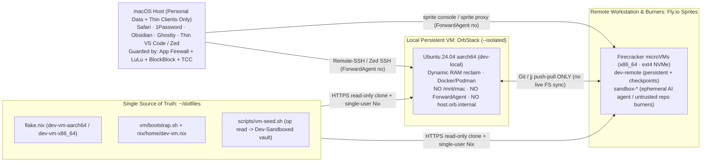

# macOS Supply-Chain Hardening Plan

Comprehensive, layered plan to isolate development workflows from personal host data against wide-ranging supply-chain compromises.

---

## 1. Threat Model, Hardware Baseline & Target Architecture

### Threat Model
* **In scope (primary threat):** Opportunistic, wide-ranging software supply-chain compromises in development dependencies and extensions—malicious `npm`/`npx` `postinstall` scripts, compromised Rust `build.rs` or proc-macros triggered on build or file open (`rust-analyzer`), trojanized Python/Go/OCI packages, compromised Obsidian/Raycast/Cursor/VS Code/Fisher plugins, prompt-injected AI coding agents, or poisoned third-party Nix binary caches.
* **Goal:** Even if arbitrary code executes inside a project, package manager, build tool, or AI coding agent, it **cannot** read personal files (`~/Documents`, iCloud Drive `PKM` vault), exfiltrate host browser cookies/sessions, steal SSH/signing keys or personal 1Password vaults, or silently pivot back into `~/dotfiles` to backdoor future macOS rebuilds.
* **Out of scope:** Targeted nation-state zero-days and physical device theft (FileVault, SIP, Gatekeeper, and Touch ID `sudo` are already enabled).

### Hardware & OS Baseline
* **Machine:** MacBook Pro (`Denniss-MacBook-Pro`, Apple Silicon `arm64`, 10 cores, **16 GB unified memory**)
* **OS:** macOS 27.0.1 (`26A434`), declaratively managed via `nix-darwin` + `home-manager` + `nix-homebrew` in `~/dotfiles`

### Target Architecture



### Core Architectural Principles
1. **macOS Host = Personal Data + Thin Clients Only:** Zero `~/workspace`, zero Rust/Node/Go/Python toolchains, zero plaintext SSH keys or dev tokens, and host editors limited to thin **VS Code** (`Remote-SSH` / `Flyio.sprites-for-vscode`) and **Zed** (native SSH remote development) connecting to remote VMs.
2. **Local Persistent VM = OrbStack (`--isolated`, Ubuntu 24.04 `aarch64`):** Gives the best 16 GB RAM ergonomics via dynamic memory reclaim and replaces `docker-desktop`, while `--isolated` disables host `/mnt/mac` mounts, host SSH agent forwarding, `host.orb.internal`, and USB/audio/serial passthrough.
3. **Remote Persistent Workstation + Burners = Fly.io Sprites (`x86_64`):** Hardware-isolated Firecracker microVMs with persistent `ext4` NVMe storage, scale-to-zero hibernation, and instant copy-on-write checkpoints (`sprite checkpoint create` / `sprite restore`) for safe experimentation and autonomous AI agents (`claude`, `opencode`).
4. **Identical Environments via `~/dotfiles`:** Both `dev-local` (`dev-vm-aarch64`) and `dev-remote` (`dev-vm-x86_64`) run the exact same `vm/bootstrap.sh` + `nix/home/dev-vm.nix` Home Manager closure, while VS Code auto-installs `remote.SSH.defaultExtensions` and Zed runs its remote server/LSPs directly inside each VM over SSH.
5. **One-Way Dotfiles Trust & Git-Only Sync:** Both VMs clone `~/dotfiles` over **read-only HTTPS** (never given write credentials to `~/dotfiles`), and state moves between `dev-local` and `dev-remote` strictly via `git`/`jj` push/pull—never live bidirectional file sync (which would replicate poisoned `.git/hooks`, `build.rs`, or `.envrc` files).

---

## 2. System Audit Summary (Observed Baseline)

### Already Strong
* **Declarative OS & Pinned Homebrew:** `flake.nix` and `nix/darwin/default.nix` pin `homebrew-core` and `homebrew-cask` in `flake.lock` with `mutableTaps = false`.
* **Platform Protections:** FileVault (`On`), SIP (`enabled`), Gatekeeper (`assessments enabled`), and Touch ID `sudo` (`security.pam.services.sudo_local.touchIdAuth = true`) are active.
* **Auto-Update Hygiene:** `nix/home/darwin.nix` disables Sparkle background auto-updates for `Contexts`, `Hammerspoon`, `Karabiner-Elements`, `Marta`, and `TopNotch`; `Ghostty` sets `auto-update = off`.
* **Partial Credential Hygiene:** `configs/git/config` uses 1Password's `op-ssh-sign`; `~/.ssh/config` defaults `Host *` to 1Password's `agent.sock`; `gh` uses Keychain (`plaintext_oauth=False`); Docker uses `credsStore=osxkeychain`.
* **VS Code Host Footprint:** Only 4 extensions installed (`remote-ssh`, `remote-ssh-edit`, `remote-explorer`, `ayu`).

### Exposures to Remediate

| Severity | Surface | Current State Observed | Risk |
| :--- | :--- | :--- | :--- |
| **Critical** | **Host Dev Toolchains & `PATH`** | `~/workspace` on host; `nix/home/default.nix` installs `rustup`, `trunk`, `sccache`, `kache`, `cargo-*`; `~/.cargo/bin` has **29 binaries**; `~/.local/bin` has **12 binaries** (`fig`, `lvim`, `node`, `claude`, `cursor-agent`, etc.); `~/.npm/_npx` cache present; `configs/fish/config.fish` **prepends** (`-P`) `~/go/bin`, `~/.cargo/bin`, `~/.local/bin` ahead of Nix/system paths; `direnv` has **5** allowed `.envrc` entries. | Compromised crates (`build.rs` / proc-macros), `npx` scripts, or `.envrc` execute as `denniskempin` on host and can shadow `git`/`ssh`/`op` via `PATH` precedence. |
| **Critical** | **Local AI Daemons & URL Handlers** | `opencode serve --service` listening on `127.0.0.1:49374`; `crit _serve` on `127.0.0.1:62660`; `~/Applications/Claude Code URL Handler.app` present; `~/.claude.json` and `~/.claude/settings.json` are `0644`. | Localhost listeners and URL handlers run with full host user access; browser/SSRF or prompt injection pivots straight into host files. |
| **High** | **Hammerspoon IPC Bridge** | `configs/hammerspoon/init.lua` loads `require("hs.ipc")`. | Hammerspoon holds Accessibility & Input Monitoring TCC permissions; `hs.ipc` lets any unprivileged host process drive UI/keystrokes via `hs -c`. |
| **High** | **Plaintext Keys & `ForwardAgent`** | `~/.ssh/id_rsa`, `~/.ssh/id_rsa_devc`, `~/.ssh/authorized_keys`, and `~/.kube/config` on disk; `~/.ssh/config` sets `ForwardAgent yes` (`Host sres.devpod`) and `Include ~/.orbstack/ssh/config` + `Include "gitpod/config"`. | Infostealers immediately harvest on-disk keys/`kubeconfig`; `ForwardAgent yes` exposes host SSH signing to remote/VM environments. |
| **High** | **Obsidian Vault (`PKM` in iCloud)** | Restricted Mode **OFF**; **8** enabled plugins (`obsidian-git`, `cm-editor-syntax-highlight-obsidian`, `obsidian-kanban`, `battery-indicator`, `obsidian-style-settings`, `periodic-notes`, `key-promoter`, `helix-motions`); **14** plugin dirs on disk (**7** disabled leftovers: `advanced-random-note`, `calendar`, `helix`, `obsidian-minimal-settings`, `obsidian-outliner`, `obsidian-tasks-plugin`, `readwise-official`). | Unsandboxed Electron/Node.js execution inside iCloud Drive; `obsidian-git` runs host `git` + network operations from plugin JS. |
| **High** | **Raycast Extensions** | **26** community extensions + `node_modules` in `~/.config/raycast/extensions` (including third-party `1password by khasbilegt`, `apple-notes`, `cursor-agents`, `raycast-gemini`, `perplexity`, `browser-tabs`, `safari`, `google-chrome`, `firefox-tabs`, `zen-browser`, `aerospace`, `bunch`). | Third-party JS/Node bundles running unsandboxed on host; community `1password` and browser/notes integrations are high-value targets. |
| **Medium** | **Cursor Extensions & IDE Settings** | Cursor is installed on host with **28** extensions in `~/.cursor/extensions` (`rust-analyzer`, `vscode-lldb`, `prettier`, `shell-format`, `shellcheck`, `retroassembler`, etc.) plus `cursor`/`cursor-agent` in `~/.local/bin`; `configs/vscode/settings.json` enables `go.toolsManagement.autoUpdate`, `chat.mcp.gallery.enabled`, and `geminicodeassist.updateChannel: dogfood`. | Cursor adds unnecessary host-side extension/agent surface (to be **removed completely**); VS Code auto-update/MCP settings allow unreviewed background updates and local proc-macro execution. |
| **Medium** | **Nix / Homebrew / LaunchDaemon Drift** | `nix/darwin/default.nix` trusts `https://devenv.cachix.org` in root `nix-daemon`; `nix/darwin/homebrew.nix` has `cleanup = "none"`; duplicate `~/Applications/Visual Studio Code.app`; orphaned root `LaunchDaemons` (`dev.orbstack.OrbStack.privhelper.plist`, `com.microsoft.*`, `com.adobe.acc.installer.v2.plist`, `us.zoom.*`) and `ninja.kunobi.kache.plist`; unpinned `fisher` plugins + `thefuck`. | Compromised third-party Nix cache runs as `root`; `cleanup = "none"` allows un-declared daemons (`opencode`, `crit`) to persist. |
| **Medium** | **Host Network Exposure** | macOS Application Firewall is **disabled** (`State = 0`), Stealth Mode is **off**, and `ControlCenter` (AirPlay Receiver) listens on `*:5000` and `*:7000`. | Unfiltered inbound local listeners and no outbound exfiltration visibility. |

---

## 3. Hardening Tasks by Layer

### Layer 1: Host OS & `~/dotfiles` Quick Hardening
- [x] **Disable Hammerspoon IPC in `configs/hammerspoon/init.lua`:** Commented out `require("hs.ipc")` and reloaded Hammerspoon (`hs -c` disabled).
- [x] **Remove third-party root Nix cache in `nix/darwin/default.nix`:** Removed `https://devenv.cachix.org` and `trusted-public-keys` from `nix.settings` so `nix-daemon` trusts only `cache.nixos.org`.
- [x] **Enable macOS Application Firewall & Stealth Mode in `nix/darwin/defaults.nix`:**
  ```nix
  networking.applicationFirewall = {
    enable = true;
    enableStealthMode = true;
    blockAllIncoming = false;
  };
  ```
- [x] **Close unnecessary network listeners:** Kept AirDrop / AirPlay Receiver enabled by choice; protected by macOS Application Firewall.
- [x] **Stop host AI daemons & clean unmanaged apps/daemons:**
  - Stopped `opencode serve --service` and `crit _serve` (verified no longer listening).
  - Deleted `~/Applications/Claude Code URL Handler.app` and the duplicate unmanaged `~/Applications/Visual Studio Code.app`.
  - Locked down permissions on leftover Claude configs (`chmod 600 ~/.claude.json ~/.claude/settings.json`).
  - Unloaded and removed orphaned `/Library/LaunchDaemons/com.microsoft.*` plists (keeping `us.zoom.*`, `com.adobe.acc.installer.v2.plist`, and `dev.orbstack.OrbStack.privhelper.plist` for installed/planned apps).
- [x] **Restore Homebrew cleanup enforcement:** Ran pre-rebuild drift check, uninstalled `thefuck` and `docker-desktop`, set `homebrew.onActivation.cleanup = "check"` in `nix/darwin/homebrew.nix`, and applied `darwin-rebuild switch --flake ~/dotfiles`.
- [x] **Fix `$PATH` precedence & stale integrations in `configs/fish/config.fish`:**
  - Switched `fish_add_path` to `-P -a -m` in `configs/fish/config.fish` (and replaced `. "$HOME/.cargo/env"` in `configs/bash/bashrc`) so mutable user paths always come after `/usr/bin`, Nix, and Homebrew.
  - Removed stale Docker Desktop, Windsurf, LM Studio, and OrbStack shell-init blocks from `configs/fish/config.fish`.
- [x] **Lock down `direnv` on host:** Created `configs/direnv/direnv.toml` with exact whitelist (`/Users/denniskempin/dotfiles/.envrc`), linked via `nix/home/links.nix`, and cleared `~/.local/share/direnv/allow/*`.
- [x] **Pin Fish plugins via Nix:** Replaced `configs/fish/fish_plugins` (and `thefuck`) with Nix-pinned `pkgs.fishPlugins.{fzf-fish,colored-man-pages,grc,plugin-git,fish-you-should-use}` loaded via `fish/conf.d/10-nix-plugins.fish`.

---

### Layer 2: Credentials, SSH Keys, Tokens & Browser/TCC Isolation
- [x] **Eliminate plaintext SSH private keys on host:**
  - Verified `~/.ssh/id_rsa*` are absent and imported key is stored in 1Password (`Personal` + `Dev` vaults); deleted `~/.ssh/authorized_keys` from disk.
- [x] **Remove SSH agent forwarding & stale includes in `~/.ssh/config`:**
  - Replaced `~/.ssh/config` via `configs/ssh/config` (`nix/home/links.nix`): removed `ForwardAgent yes` (`Host sres.devpod`), removed `Include "gitpod/config"` and `Include ~/.orbstack/ssh/config`, and enforced `ForwardAgent no` across `Host *` and all hosts.
- [x] **Harden 1Password SSH Agent:**
  - Created `configs/1password/agent.toml` (linked to `~/.config/1Password/ssh/agent.toml` via Home Manager) listing `Personal` and `Dev` vaults; `Personal SSH Key (ED25519)` is active via `agent.sock` and per-request Touch ID is enabled. *(Note: if the `Dev` key should also be served on host SSH, ensure its 1Password item category is **SSH Key** and toggle **Use the SSH Agent** off/on once; 1Password CLI desktop integration can stay off until needed for `vm-seed.sh`.)*
- [ ] **Create a `Dev` 1Password Vault & Service Account:**
  - [x] Created the separate `Dev` vault in 1Password (kept personal/financial credentials strictly in `Personal`).
  - [ ] Create a **read-only 1Password Service Account** scoped strictly to `Dev` for `op run` inside VMs (needed for Phase 4/5 `scripts/vm-seed.sh`).
- [x] **Eliminate static cloud & package tokens from host:**
  - Deleted `~/.kube` and logged out `gh` CLI on host; verified `~/.aws`, `~/.config/gcloud`, `~/.npmrc`, `~/.pypirc`, `~/.cargo/credentials*`, `~/.netrc`, and `~/.git-credentials` are absent on host.
- [x] **Browser & TCC compartmenting:**
  - Reserve **Safari** (`1Password for Safari` + `Wipr 2`) exclusively for personal high-trust sessions (banking, email, iCloud, 1Password web, personal Google).
  - Use **Chrome** (clean profile, minimal/zero extensions) only for dev previews and documentation.
  - Audited macOS Full Disk Access (`Ghostty`, `Visual Studio Code`, `Zed`, `Obsidian`, `Raycast` without FDA; confirmed external access to `~/Library/Mobile Documents/.../PKM` returns `Operation not permitted`).

---

### Layer 3: Host Application Hardening (Obsidian, Raycast, Editors)

#### Obsidian (`~/Library/Mobile Documents/com~apple~CloudDocs/Files/PKM`)
- [x] **Delete disabled plugin remnants:** Removed the 7 unused plugin directories under `PKM/.obsidian/plugins/` (`advanced-random-note`, `calendar`, `helix`, `obsidian-minimal-settings`, `obsidian-outliner`, `obsidian-tasks-plugin`, `readwise-official`).
- [x] **Retire `obsidian-git`:** Uninstalled `obsidian-git`; relying on iCloud Drive for sync (never syncing `.obsidian/plugins/` from an external Git remote).
- [x] **Minimize & freeze remaining plugins:** Audited remaining plugins, turned off auto-updates, and adopted a **7–14 day** wait before manual updates.
- [ ] **Block `Obsidian.app` network access (in Layer 6):** Deny outbound connections for `Obsidian.app` in LuLu—iCloud sync happens via macOS's `bird` daemon, so Obsidian itself needs zero direct internet access.

#### Raycast (`~/.config/raycast/extensions`)
- [x] **Remove community 1Password extension:** Removed all community extensions from `~/.config/raycast/extensions` (use official `1Password.app` Quick Access shortcut instead).
- [x] **Prune high-privilege & unused extensions:** Verified `~/.config/raycast/extensions` has zero third-party extensions remaining (only the `node_modules` symlink to `Raycast.app`).

#### Cursor Removal & Thin-Client Editors (VS Code + Zed)
- [x] **Remove Cursor completely:**
  - Removed `"cursor"` from `homebrew.casks` in `nix/darwin/homebrew.nix` and uninstalled Cursor via `brew uninstall --cask --force cursor`.
  - Removed the Cursor config symlink from `nix/home/links.nix` and deleted `configs/cursor/`.
  - Deleted host state and binaries: `~/.cursor`, `~/Library/Application Support/Cursor`, Cursor caches/preferences/saved state, `~/.local/share/cursor-agent`, and `~/.local/bin/{cursor,cursor-agent,agent,node}`.
- [x] **Keep VS Code as a hardened thin client (`configs/vscode/settings.json`):**
  - Verified host extensions remain minimal (`ms-vscode-remote.remote-ssh`, `ms-vscode-remote.remote-ssh-edit`, `ms-vscode.remote-explorer`, `teabyii.ayu`).
  - Added strict security & remote defaults to `configs/vscode/settings.json`:
    ```jsonc
    "security.workspace.trust.enabled": true,
    "security.workspace.trust.startupPrompt": "always",
    "task.allowAutomaticTasks": "off",
    "extensions.autoUpdate": false,
    "go.toolsManagement.autoUpdate": false,
    "chat.mcp.gallery.enabled": false,
    "rust-analyzer.cargo.buildScripts.enable": false,
    "rust-analyzer.procMacro.enable": false,
    "remote.restoreForwardedPorts": false,
    "remote.autoForwardPortsSource": "output",
    "remote.SSH.defaultExtensions": [
      "rust-lang.rust-analyzer",
      "vadimcn.vscode-lldb",
      "tamasfe.even-better-toml",
      "esbenp.prettier-vscode",
      "timonwong.shellcheck",
      "yzhang.markdown-all-in-one"
    ]
    ```
    *(Note: `rust-analyzer` disabled-buildScripts/procMacro defaults protect you if a local folder is ever opened on host; override inside remote VM settings when working in `dev-local` / `dev-remote`.)*
- [x] **Add and harden Zed as a thin SSH client (`nix/darwin/homebrew.nix` + `configs/zed/settings.json`):**
  - Added `"zed"` to `homebrew.casks` in `nix/darwin/homebrew.nix`, created `configs/zed/settings.json` (`"auto_update": false`, telemetry off, `rust-analyzer` `buildScripts`/`procMacro` off on host), wired it into `nix/home/links.nix`, and activated via `sudo darwin-rebuild switch --flake ~/dotfiles` (`/Applications/Zed.app` installed and `~/.config/zed/settings.json` linked). Use Zed strictly via native SSH remote development against `dev-local` and `dev-remote`.

---

### Layer 4: Unified Dev VM Infrastructure (`~/dotfiles` + OrbStack + Fly.io Sprites)

#### A. Shared `~/dotfiles` VM Configuration
- [x] **Create `nix/home/dev-vm.nix`:**
  - Imports `./cli.nix`, `./linux.nix`, `./links-cli.nix`.
  - Moved Rust and dev packages (`rustup`, `cargo-deny`, `cargo-nextest`, `cargo-vet`, `kache`, `sccache`, `trunk`) out of host `nix/home/default.nix` into `dev-vm.nix`, plus `_1password-cli`, `docker-client`, `mosh`, `nodejs_22`, `openssh`, `python3`, and `tmux`.
  - Linked Linux-safe `configs/git/config-vm` -> `~/.config/git/config` inside VMs (sharing `delta`/`merge`/`diff` settings, without macOS `op-ssh-sign`, and including `~/.config/git/config.local`).
  - Configured `~/.config/tmux/tmux.conf` (OSC 52 clipboard + `fish` default shell) and `~/.npmrc` (`ignore-scripts=true`).
- [x] **Add dual-architecture VM targets in `flake.nix`:**
  - Added `mkDevVm` (`dev-vm-aarch64` for OrbStack and `dev-vm-x86_64` for Fly.io Sprites) using `--impure` `$USER`/`$HOME` resolution.
- [x] **Create `vm/bootstrap.sh` (one idempotent provisioner for both VMs):**
  - Installs base apt packages (`curl`, `git`, `xz-utils`), clones `~/dotfiles` over **read-only HTTPS**, installs single-user Nix (`--no-daemon`) trusting only `cache.nixos.org`, applies `dev-vm-${arch}`, and installs the `stable` Rust toolchain.
- [x] **Create `scripts/vm-seed.sh <dev-local|dev-remote>` (host-side 1-command secret seeder):**
  - Uses `op read` (behind Touch ID) strictly against the `Dev` vault.
  - Injects a **separate, per-VM fine-grained GitHub PAT** over stdin (scoped *only* to active project repos and **excluding `dotfiles`**), generates a VM-local `ed25519` commit-signing key, optionally seeds the read-only `Dev` Service Account token, and optionally clones `vm/repos.txt` (`--clone-repos`).
- [x] **Add a unified `dev` Fish wrapper in `configs/fish/config.fish`:**
  - `dev local` attaches to `dev-local` `tmux` over SSH (`ForwardAgent no`).
  - `dev remote` attaches to Fly.io Sprite `dev-remote` `tmux` via `sprite exec --tty` (or `ssh dev-remote`).

#### B. Local Persistent VM — OrbStack (`--isolated`)
- [ ] **Swap `docker-desktop` for `orbstack` in `nix/darwin/homebrew.nix`** and rebuild (`darwin-rebuild switch`).
- [ ] **Create an explicitly isolated Ubuntu 24.04 ARM64 VM:**
  ```bash
  orb create --isolated -u denniskempin ubuntu:noble dev-local
  ```
  - `--isolated` enforces: **no `/mnt/mac` host filesystem mount**, **no SSH agent forwarding**, **no `host.orb.internal` host-loop access**, and **no USB/audio/serial passthrough**.
  - **Rule:** Never create a non-isolated OrbStack machine (`--isolated` on every VM).
- [ ] **Bootstrap & seed `dev-local`:**
  ```bash
  orb -m dev-local bash < ~/dotfiles/vm/bootstrap.sh
  ./scripts/vm-seed.sh dev-local --clone-repos
  ```
- [ ] **Configure explicit non-forwarding SSH entry in `~/.ssh/config`:**
  *(Already added in `configs/ssh/config` during Phase 2: `Host dev-local` -> `dev-local.orb.local`, `ForwardAgent no`.)*
  *(Use `dev-local` in VS Code `Remote-SSH` or Zed's SSH remote dialog—VS Code's `remote.SSH.defaultExtensions` installs extensions automatically inside `dev-local`, and Zed downloads its remote server inside `dev-local`.)*
- [ ] **Evacuate host dev state into `dev-local`:**
  - **CAUTION:** `~/workspace` currently holds personal/non-code directories (**`Wedding Photos`**, **`archive`**, **`pkm`**) and hardware **`keyboards`** KiCad libraries used by host KiCad. Move `Wedding Photos`, `archive`, `pkm`, and KiCad libraries out to `~/Pictures` / `~/Documents` first—**never blindly `rm -rf ~/workspace`!**
  - Re-clone active software repos cleanly inside `dev-local` (do **not** copy existing `target/` or `node_modules/` directories from host).
  - Once verified, delete only the evacuated software repos plus host `~/.cargo`, `~/go`, `~/.npm`, `~/.codeium`, unmanaged binaries in `~/.local/bin` (`claude`, `fig`, `lvim`, etc.), and unload/delete `~/Library/LaunchAgents/ninja.kunobi.kache.plist`.

#### C. Remote Workstation & Ephemeral Burners — Fly.io Sprites (`sprites.dev`)
- [ ] **Install & authenticate the `sprite` CLI on macOS:**
  - Inspect and run the official installer (`curl -fsSL https://sprites.dev/install.sh | less` then install) or package cleanly, and authenticate via `sprite login` (or store `SPRITES_TOKEN` in 1Password and invoke via `op run`).
- [ ] **Provision the persistent remote workstation (`dev-remote`):**
  ```bash
  sprite create dev-remote
  ```
  - Confirm Sprite HTTP URL visibility stays **private / authenticated** (never expose unauthenticated public URLs for dev servers).
  - Bootstrap identically using the shared script (`x86_64` -> `dev-vm-x86_64`):
    ```bash
    sprite exec -s dev-remote -- bash -s < ~/dotfiles/vm/bootstrap.sh
    ```
  - Seed remote-only scoped credentials:
    ```bash
    ./scripts/vm-seed.sh dev-remote
    ```
    *(Uses a **distinct** fine-grained GitHub PAT/key from `dev-local` so compromise of one VM doesn't invalidate or pivot through the other.)*
- [ ] **Take an immediate golden checkpoint:**
  ```bash
  sprite checkpoint create -s dev-remote
  ```
  - Restoring a clean baseline after risky dependency installs or agent runs takes <1 second via `sprite restore <checkpoint-id>`.
- [ ] **Connect editors & terminals identically to `dev-local`:**
  - **Terminal:** `sprite console -s dev-remote` (supports detachable sessions with `Ctrl+\` + `sprite sessions attach`, or run `tmux` inside).
  - **VS Code & Zed:** Tunnel an internal `sshd` (listening only on loopback inside the Sprite) via `sprite proxy` in `~/.ssh/config` (`ForwardAgent no`) so **both** VS Code (`Remote-SSH`, auto-installing `remote.SSH.defaultExtensions`) and **Zed** (native SSH remote development) connect identically to `dev-local` and `dev-remote`. Optionally install `Flyio.sprites-for-vscode` in VS Code as well.
- [ ] **Use ephemeral burner Sprites for high-risk tasks:**
  - Whenever auditing an unfamiliar repo, running `npx` CLIs, or letting `claude` / `opencode` run autonomously with wide tool approval:
    ```bash
    sprite create sandbox-task1
    # work / run agent / push branch
    sprite destroy sandbox-task1
    ```

#### D. Recreation & Hygiene Playbook
- [ ] **Recreate `dev-local` cleanly (~3–5 min):**
  ```bash
  orb delete dev-local
  orb create --isolated -u denniskempin ubuntu:noble dev-local
  orb -m dev-local bash < ~/dotfiles/vm/bootstrap.sh
  ./scripts/vm-seed.sh dev-local
  ```
- [ ] **Recreate `dev-remote` cleanly (~3–5 min):**
  - Restore your clean baseline via `sprite restore <baseline-checkpoint-id>`, or `sprite destroy dev-remote && sprite create dev-remote` + re-run `vm/bootstrap.sh` & `vm-seed.sh`.

---

### Layer 5: Host Outbound Firewall & Persistence Monitoring
- [ ] **Install `LuLu` (or `Little Snitch`) & `BlockBlock` via `nix/darwin/homebrew.nix`:**
  - Add `"lulu"` (open-source application-level outbound firewall) and `"blockblock"` (real-time persistence monitor for new `LaunchAgents`/`LaunchDaemons`/Login Items) to `homebrew.casks`.
- [ ] **Apply baseline LuLu outbound block rules:**
  - **Block outbound internet completely:** `Obsidian.app`, `Hammerspoon.app`, `OmniWM.app`, `Karabiner-Elements`.
  - **Default prompt mode:** Require explicit approval for unexpected outbound connections from `curl`, `python3`, `node`, or shells on the macOS host.

---

## 4. Recommended Implementation Order

Execute in this sequence to get the biggest risk reduction immediately without disrupting your daily workflow:

1. **Phase 1 — Host Quick Wins & `~/dotfiles` Hygiene (~30 min)**
   - Comment out `require("hs.ipc")` in `configs/hammerspoon/init.lua`.
   - Remove `devenv.cachix.org` in `nix/darwin/default.nix`; enable `networking.applicationFirewall` in `nix/darwin/defaults.nix`; turn off AirPlay Receiver.
   - Stop `opencode serve` and `crit _serve`, uninstall undeclared formulae, delete `~/Applications/Claude Code URL Handler.app` and duplicate `~/Applications/Visual Studio Code.app`, `chmod 600 ~/.claude*`, clean orphaned `/Library/LaunchDaemons`.
   - Fix `$PATH` append order and stale lines in `configs/fish/config.fish`, lock down host `direnv`, migrate Fisher plugins to Nix, run the drift check, restore `cleanup = "check"` in `nix/darwin/homebrew.nix`, and run `darwin-rebuild switch`.
2. **Phase 2 — Credential & Secret Lockdown (~30–45 min)**
   - Import and delete `~/.ssh/id_rsa` and `~/.ssh/id_rsa_devc`; delete `~/.ssh/authorized_keys`.
   - Remove `ForwardAgent yes` and `gitpod`/`orbstack` auto-includes from `~/.ssh/config`.
   - Configure `~/.config/1Password/ssh/agent.toml` + per-request Touch ID; create `Dev-Sandboxed` vault + read-only Service Account; audit Safari vs. Chrome separation and TCC Full Disk Access.
3. **Phase 3 — Host App Hardening & Editor Cleanup (~30 min)**
   - Delete the 7 unused Obsidian plugin dirs and retire `obsidian-git`.
   - Remove Raycast's `1password by khasbilegt`, `cursor-agents`, and other unused/high-privilege Raycast extensions.
   - Remove Cursor completely (`homebrew.nix`, `nix/home/links.nix`, `configs/cursor/`, `~/.cursor`, `~/Library/Application Support/Cursor`, `~/.local/bin/cursor*`).
   - Add `"zed"` to `nix/darwin/homebrew.nix` + `configs/zed/settings.json` (`"auto_update": false`), and harden `configs/vscode/settings.json` with `remote.SSH.defaultExtensions`.
4. **Phase 4 — Build Shared VM Flake & Bootstrap Scripts (~1 hour)**
   - Add `nix/home/dev-vm.nix`, Linux `git/config`, `dev-vm-aarch64` + `dev-vm-x86_64` in `flake.nix`, `vm/bootstrap.sh`, `scripts/vm-seed.sh`, and `dev` Fish wrapper.
5. **Phase 5 — Stand Up OrbStack (`--isolated`) + Fly.io Sprites & Evacuate Host (~1–2 hours)**
   - Replace `docker-desktop` with `orbstack`; create, bootstrap, seed, and verify `dev-local`.
   - Install `sprite` CLI; create, bootstrap, seed, and checkpoint `dev-remote` (plus `sprite proxy` SSH config for VS Code & Zed).
   - Re-clone `~/workspace` repos into VMs; move `~/.kube/config` into the target VM; wipe host `~/workspace`, `~/.cargo`, `~/go`, `~/.npm`, `~/.codeium`, unmanaged `~/.local/bin`, and `ninja.kunobi.kache.plist`.
6. **Phase 6 — Outbound Firewall & Ongoing Cadence (~30 min + ongoing)**
   - Install and configure `LuLu` + `BlockBlock` via `nix/darwin/homebrew.nix`.
   - **Ongoing habits:** Wait 7–14 days before updating Obsidian/Raycast/editor plugins; run risky repos or autonomous agents only in ephemeral Sprites; refresh `dev-local` and `dev-remote` cleanly once a quarter.

---

## 5. Verification Checklist

Run these checks after completing the rollout to confirm every boundary holds:

### macOS Host Checks
- [x] **Firewall & Listeners:**
  ```bash
  /usr/libexec/ApplicationFirewall/socketfilterfw --getglobalstate   # Verified: Firewall is enabled. (State = 1)
  /usr/libexec/ApplicationFirewall/socketfilterfw --getstealthmode   # Verified: Firewall stealth mode is on
  /usr/sbin/lsof -iTCP -sTCP:LISTEN -n -P                            # Verified: no opencode/crit (AirDrop/ControlCenter kept enabled by choice)
  ```
- [ ] **SSH & Credential Hygiene:**
  ```bash
  ls -la ~/.ssh                                                      # Expected: no id_rsa*, no authorized_keys
  grep -iE 'forwardagent|orbstack|gitpod' ~/.ssh/config              # Expected: ForwardAgent no; no auto-includes
  ls -la ~/.kube ~/.npmrc ~/.pypirc ~/.cargo 2>&1                    # Expected: absent on host
  ```
- [x] **Homebrew & Nix Hygiene:**
  ```bash
  # Verified: darwin-rebuild switch with cleanup = "check" passed and devenv cache removed from /etc/nix/nix.conf
  ```
- [ ] **Editors & Obsidian:**
  - Verify Cursor is completely removed (`ls /Applications/Cursor.app ~/.cursor ~/.local/bin/cursor* 2>&1` all absent).
  - Verify VS Code and Zed both connect cleanly to `dev-local` and `dev-remote` over SSH (`Remote-SSH` / native Zed SSH) with `rust-analyzer` running inside the VMs, not on macOS.
  - Obsidian `PKM/.obsidian/plugins/` contains only actively audited plugins (no `obsidian-git`, no disabled leftovers).

### OrbStack (`dev-local`) Isolation Checks (Run *Inside* `dev-local`)
- [ ] **Zero host mounts:** `ls /mnt/mac` fails (`No such file or directory`).
- [ ] **Zero SSH agent forwarding:** `env | grep SSH_AUTH_SOCK` returns nothing.
- [ ] **Host loop blocked:** `curl -s --max-time 2 http://host.orb.internal` fails / does not resolve.
- [ ] **Package hardening & Nix parity:** `npm config get ignore-scripts` prints `true`; `which cargo rust-analyzer hx fish` resolves inside Nix/VM paths; `git config --get gpg.ssh.program` does **not** reference `/Applications/1Password.app`.

### Fly.io Sprites (`dev-remote`) Checks
- [ ] **Checkpoint exists:** `sprite checkpoint list -s dev-remote` shows a clean post-bootstrap baseline checkpoint.
- [ ] **Dotfiles read-only:** `git -C ~/dotfiles remote -v` uses `https://` and cannot push backdoors to your `~/dotfiles` repo.
- [ ] **Token scope verified:** Attempting to push a test commit to `~/dotfiles` from either `dev-local` or `dev-remote` fails with `403` / permission denied.
