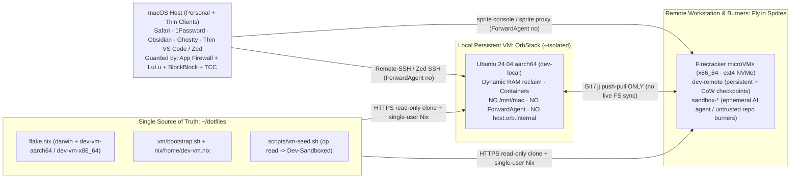

# System & Supply-Chain Security Architecture

This document describes the high-level security model, architectural boundaries, and key decisions governing how this system protects personal data and host integrity against software supply-chain compromises.

> For the concrete audit findings, migration tasks, and verification commands, see [hardening-plan.md](file:///Users/denniskempin/dotfiles/docs/hardening-plan.md).

---

## 1. Threat Model & Security Goal

* **Primary Threat (In Scope):** Opportunistic, wide-ranging supply-chain compromises in developer tooling and extensions—such as malicious `npm`/`npx` `postinstall` scripts, compromised Rust `build.rs` or proc-macros (triggered on build or IDE file open), trojanized Python/Go/OCI packages, compromised editor/Obsidian/Raycast/shell plugins, prompt-injected AI coding agents, or poisoned third-party binary caches.
* **Security Goal:** **Blast-radius containment.** Even if arbitrary code executes inside a project, package manager, language server, or AI coding agent, it must not be able to:
  * Read personal files (`~/Documents`, iCloud Drive `PKM` vault).
  * Exfiltrate host browser cookies or active personal sessions.
  * Harvest SSH keys, cloud credentials, or personal 1Password vaults.
  * Silently pivot back into `~/dotfiles` to backdoor future macOS rebuilds.
* **Out of Scope:** Targeted nation-state zero-days and physical device theft (mitigated at the platform baseline by FileVault, SIP, Gatekeeper, and Touch ID `sudo`).

---

## 2. Core Architectural Decisions

### 1. Thin-Client macOS Host (Zero Local Dev State)
The macOS host is reserved strictly for personal workflows and thin remote clients. It holds **no** `~/workspace`, **no** language toolchains (`rustup`, `node`, `go`, `cargo`), **no** local AI coding daemons, and **no** plaintext dev credentials. Editors (`VS Code` and `Zed`) run on macOS purely as UI shells connecting over SSH to language servers, debuggers, and formatters inside isolated VMs.

### 2. Three-Tier Compute & Isolation Model
Workloads are separated by trust and permanence:
* **macOS Host (High Trust, Personal):** Personal apps, 1Password, Safari, Obsidian, and thin-client terminals/editors.
* **Local Persistent VM (`dev-local` via OrbStack `--isolated`):** Primary day-to-day local Linux environment (`Ubuntu 24.04 aarch64`) chosen for Apple Silicon memory efficiency (dynamic RAM reclaim) and container support. Every VM is created with `--isolated` to strictly disable `/mnt/mac` host mounts, SSH agent forwarding, `host.orb.internal` host-loop access, and USB/audio/serial passthrough.
* **Remote Workstation & Ephemeral Burners (Fly.io Sprites):** Hardware-isolated Firecracker microVMs (`x86_64`) with persistent `ext4` NVMe storage, scale-to-zero hibernation, and sub-second copy-on-write checkpoints:
  * `dev-remote` serves as a persistent remote workstation with golden baseline checkpoints (`sprite checkpoint create` / `restore`).
  * `sandbox-*` sprites serve as disposable burners for auditing unfamiliar repos, running `npx` CLIs, or running autonomous AI agents (`claude`, `opencode`) with wide tool permissions.

### 3. One-Way Dotfiles Trust & Git-Only State Movement
* **Read-only configuration propagation:** Both `dev-local` and `dev-remote` run the exact same Home Manager closure (`vm/bootstrap.sh` + `nix/home/dev-vm.nix`), cloning `~/dotfiles` over **read-only HTTPS**. VMs never receive write credentials to `~/dotfiles`, preventing a compromised VM from backdooring host configuration.
* **No live bidirectional file sync:** Code moves between `dev-local` and `dev-remote` strictly via `git` or `jj` push/pull. Live file-sync tools are avoided so poisoned `.git/hooks`, `build.rs`, or `.envrc` files cannot silently replicate across environments.

### 4. Declarative, Pinned Supply Chain
* **OS & Packages:** macOS configuration, Homebrew taps/casks, and CLI/VM packages are declaratively managed via `nix-darwin`, `home-manager`, and `nix-homebrew` with versions pinned in `flake.lock` (`mutableTaps = false`, `homebrew.onActivation.cleanup = "check"`).
* **Root Cache & Plugin Pinning:** The root `nix-daemon` trusts only `cache.nixos.org` (no third-party binary caches). Shell plugins (`fishPlugins.*`) are pinned through Nix rather than fetched mutably at runtime.
* **Controlled Updates:** Background auto-updaters (Sparkle for macOS apps, Zed's auto-updater, VS Code extension auto-updates, Obsidian plugin auto-updates) are disabled. Community plugins follow a **7–14 day soak period** before manual updates.

---

## 3. Credential, Identity & Browser Isolation

* **No Plaintext Keys on Disk:** SSH private keys live inside 1Password rather than `~/.ssh/id_*`. Host SSH operations use 1Password's SSH agent, constrained by an explicit `~/.config/1Password/ssh/agent.toml` allowlist and **per-request Touch ID** confirmation.
* **Zero SSH Agent Forwarding:** `ForwardAgent no` is enforced globally and on all VM SSH configs. A compromised VM cannot use the host's SSH agent to sign commits or authenticate elsewhere.
* **Vault & Token Compartmentalization:**
  * Personal and financial credentials stay in the primary 1Password vault, never exposed to VMs.
  * Non-critical dev secrets live in a dedicated `Dev-Sandboxed` vault, accessed via a read-only Service Account.
  * Each VM (`dev-local`, `dev-remote`) is seeded via `scripts/vm-seed.sh` with its own distinct, repo-scoped fine-grained GitHub PAT (explicitly excluding `~/dotfiles`) or VM-local deploy key.
  * Cloud/cluster credentials (`kubeconfig`, `gh`, `npm`, `cargo`, `aws`, `gcloud`) are kept off the macOS host and placed only inside the specific VM that requires them (preferring short-lived OIDC/exec auth).
* **Browser & TCC Compartmenting:**
  * **Safari** is reserved exclusively for high-trust personal sessions (banking, email, iCloud, 1Password, personal Google).
  * **Chrome** (clean profile, minimal extensions) is used for dev previews and documentation.
  * **Least-privilege TCC:** Terminals, editors, Obsidian, and Raycast do not hold Full Disk Access. Hammerspoon's `hs.ipc` bridge is disabled so unprivileged host processes cannot drive UI/keystrokes through its Accessibility/Input Monitoring grants.

---

## 4. Host OS, Network & Application Hardening

* **Platform Baseline:** FileVault, System Integrity Protection (SIP), Gatekeeper, and Touch ID `sudo` remain enabled.
* **Inbound & Outbound Network Controls:**
  * **macOS Application Firewall & Stealth Mode** are enabled declaratively; unnecessary local listeners (AirPlay Receiver, local AI HTTP servers/URL handlers) are disabled.
  * **Outbound Firewall (`LuLu`):** Blocks outbound internet entirely for local-only apps (`Obsidian`, `Hammerspoon`, `OmniWM`, `Karabiner-Elements`) and prompts on unexpected outbound connections from host CLI tools (`curl`, `python3`, `node`, shells).
  * **Persistence Monitoring (`BlockBlock`):** Alerts on any new `LaunchAgents`, `LaunchDaemons`, or Login Items.
* **Safe Host Execution Defaults:**
  * System and Nix paths take precedence over user-writable `PATH` directories so mutable binaries cannot shadow `git`, `ssh`, or `op`.
  * Host `direnv` is locked down to an explicit allowlist.
  * Inside VMs, `~/.npmrc` sets `ignore-scripts=true` to block automatic `postinstall` execution.
* **Minimalist Host Apps:**
  * **Editors:** Cursor is excluded; VS Code enforces Workspace Trust, disables automatic tasks and local `rust-analyzer` build scripts/proc-macros, and auto-installs extensions only inside remote SSH targets (`remote.SSH.defaultExtensions`). Zed operates strictly as a remote SSH client.
  * **Obsidian & Raycast:** Plugins/extensions are audited and minimized; `obsidian-git` is retired so Obsidian's Electron process never invokes host `git` or network operations (iCloud Drive handles sync via macOS's `bird` daemon).

---

## 5. Lifecycle & Recovery ("Cattle, Not Pets")

Developer VMs are treated as disposable, reproducible environments rather than irreplaceable pets:
* **Fast Rollback:** Before risky dependency installs or agent runs on `dev-remote`, a checkpoint is taken (`sprite checkpoint create`) for sub-second rollback (`sprite restore`).
* **Clean Recreation:** Both `dev-local` and `dev-remote` can be destroyed and rebuilt cleanly in a few minutes using `vm/bootstrap.sh` and `scripts/vm-seed.sh`, and are refreshed on a regular quarterly cadence to clear accumulated state.
